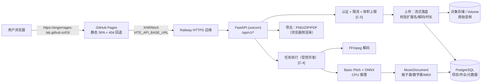

# PocketScore AI · V1.1-C.1 生产部署架构方案（Deployment Architecture）

- **目标**：给出可落地的公开部署架构，供 C.2 起实施
- **前置**：[架构审计](PocketScore-V1.1-C.1-Architecture-Audit.md) 的实测结论
- **约束**：本阶段不部署、不创建云资源；所有云侧组件标注为 PROPOSED

---

## 1. 现状与目标的差距（一句话）

前端是**静态站点**（GitHub Pages，已上线），后端是**单进程 FastAPI + SQLite + 本地文件**，
两者**尚未连通过**：线上前端没有 API 地址，后端没有公网宿主，安全面（认证/限流/并发）尚空白。

---

## 2. 公开服务架构图（目标态）



> 与当前实现的差异：`AUTH`（MISSING）、`对象存储`（MISSING）、`PostgreSQL`（PROPOSED）、
> `受控并发`（PARTIAL）。其余为 EXISTING。

---

## 3. 数据流与文件流

### 3.1 数据流（元数据）

```text
浏览器 → POST /api/v1/audio/upload          音频字节 + 文件名
API   → FFmpeg 探测/解码验证 → 时长/采样率/编码
API   → audio_assets 行（校验和去重）+ storage/audio/<sha2>/<sha256><ext>
浏览器 → POST /api/v1/transcription/jobs     引用 asset_id
API   → transcription_jobs 行（状态机 validating→transforming→completed）
Worker→ Basic Pitch → NoteEvent[] → MusicDocument（music_documents/music_events）
浏览器 → GET /api/v1/notation/{id}/both     格子谱 + 数字谱（同一份文档编译）
浏览器 → PUT /api/v1/documents/{id}         编辑后保存
```

### 3.2 文件流（字节）

| 阶段 | 位置 | 生命周期 | 现状 |
| --- | --- | --- | --- |
| 上传接收 | `data/storage/audio/<sha2>/` | 永久（去重） | ✅ 已有 |
| 解码验证 | 系统临时目录 | 请求结束即删 | ✅ 已有 |
| 推理输入 | 原文件（不复制） | — | ✅ 已有 |
| 导出产物 | **浏览器内存**（Blob） | 页面生命周期 / 用户保存 | ✅ 已有（落盘未验证） |
| 备份 | — | — | ❌ 无 |

> 关键判断：**导出产物从不经过后端**，因此后端存储与导出带宽无关；这也意味着
> 公开部署不会因导出而增加服务器负载。

---

## 4. 三套部署方案

### 方案 A：最小可行部署（首发公开测试）

```text
GitHub Pages (静态 SPA)
        │  HTTPS + CORS
        ▼
Railway Web Service (1 实例, Docker, 1 GB / 1 vCPU)
        ├── FastAPI + uvicorn
        ├── Volume /data  → SQLite + audio 文件
        └── Basic Pitch/ONNX（进程内，串行执行）
```

| 维度 | 说明 |
| --- | --- |
| 服务组成 | 1 个 Web 服务 + 1 个 Volume |
| 数据持久化 | SQLite 文件 + 音频文件同卷 |
| 并发 | 串行（1 个推理信号量），排队由 ASGI 层承担 |
| 部署难度 | 低（补 `RAILWAY_DOCKERFILE_PATH`、`$PORT`、CORS 变量即可） |
| 资源风险 | 中：200 MB 上传 + 262 MB 推理峰值，需 ≥1 GB；单副本无冗余 |
| 成本因素 | 单实例 + 卷（按 Railway 用量计价，本报告不编造具体金额） |
| 优点 | 改动最小、无额外组件、当天可上线 |
| 缺点 | 单点、SQLite 不能水平扩展、无队列（长任务占满线程） |
| 适用 | V1.1-C.2 首发验证、内部/小范围公开测试 |

### 方案 B：推荐生产部署

```text
GitHub Pages ──HTTPS/CORS──▶ Railway Web Service (API, 1–2 实例)
                                   │
                                   ├── Railway PostgreSQL（元数据/项目/作业）
                                   ├── Railway Volume 或对象存储（音频原件）
                                   └── 受控并发执行器（信号量 + 任务超时 + 取消）
```

| 维度 | 说明 |
| --- | --- |
| 服务组成 | Web 服务 + Postgres + Volume（或 S3 兼容对象存储） |
| 数据流 | 元数据入 PG，音频入对象存储/卷；DB 与文件解耦，可分别备份 |
| 并发 | 进程内信号量（默认 1–2）+ 任务超时 + 队列等待位；必要时升级到 C |
| 部署难度 | 中（需迁移 PG、加 `psycopg[binary]`、改存储适配器） |
| 资源风险 | 低–中：PG 托管备份，API 可重启不丢数据 |
| 成本因素 | Web + PG + 存储（用量计费） |
| 优点 | 数据可靠、可重启、可扩副本（读多写少场景） |
| 缺点 | 多一个数据库组件；迁移需一次性窗口 |
| 适用 | 正式公开服务（C.3 完成后的默认形态） |

### 方案 C：高并发扩展架构

```text
                    ┌──────────────────────────┐
GitHub Pages ──▶ API Gateway / Web Service (N 实例, 无状态)
                    │            │
                    │            ├─▶ PostgreSQL (managed, 连接池)
                    │            └─▶ S3 兼容对象存储
                    ▼
             Redis / 任务队列（RQ / Celery）
                    │
        ┌───────────┴────────────┐
        ▼                        ▼
  AI Worker 池 (CPU, 1 任务/实例)   导出/轻任务 Worker
```

| 维度 | 说明 |
| --- | --- |
| 服务组成 | 无状态 API ×N + Redis + AI Worker ×M + PG + 对象存储 |
| 数据流 | API 只做接收/查询，推理在 Worker；状态经 Redis + PG |
| 并发 | 水平扩展；单 Worker 串行保证内存可控（262 MB × 1） |
| 部署难度 | 高（队列、幂等、重试、进度回传、部署编排） |
| 资源风险 | 低（单点故障可控），但组件多、运维面大 |
| 成本因素 | 组件数 × 用量；空闲 Worker 也计费 |
| 优点 | 可承载多用户并发与长音频，隔离故障 |
| 缺点 | 复杂度显著上升，超出当前阶段必要范围 |
| 适用 | 用户量与推理任务显著增长后（非现在） |

### 4.4 推荐

**推荐 方案 A → 方案 B 两步走**：

1. **C.2 用方案 A 上线**：只补部署配置与最小安全项（CORS、$PORT、Dockerfile 路径、
   串行推理、请求体上限、基础限流），目标是"真实可用 + 数据不丢在重启后"。
2. **C.3 迁移到方案 B**：Postgres + 对象存储 + 备份，去掉 SQLite 单点。

理由（有证据）：
- 稳态推理 **0.26–1.13 s**、端到端 **0.5 s**（20 s 音频），单 CPU 实例足够支撑首发的低并发；
- 单任务内存峰值 **262 MB**，1 GB 实例可容纳 1 个推理 + Web 进程余量；
- 当前**无认证**，公开前用户量必然很小，方案 C 的队列/Worker 是过度设计；
- 数据可靠性是唯一不能凑合的部分 → 必须在 C.3 迁 PG，而不是长期跑 SQLite。

**不推荐方案 C 现在做**：多一个 Redis + Worker 池的运维成本，在无用户体系、无并发压力的前提下
没有收益，且会让 C.2 的上线时间显著后延。

---

## 5. 资源需求（基于实测）

| 资源 | 实测依据 | 建议 |
| --- | --- | --- |
| 内存 | 推理峰值 262 MB（120 s 音频）；FastAPI + 依赖约 180 MB 常驻 | **≥1 GB**（留出 2× 余量）；512 MB 会 OOM |
| CPU | 30 s 音频 0.26 s、120 s 音频 1.13 s（单核） | 1 vCPU 可用；并发 >1 时需 ≥2 vCPU |
| 磁盘 | 单音频 ≤200 MB（可配置）；600 s 音频约 10–20 MB | 5–10 GB 起，配保留策略 |
| 带宽 | 上传 200 MB 上限；导出不走服务端 | 常规额度足够 |
| 冷启动 | 首个任务 7.6 s（JIT + 导入） | 加启动预热，把 7.6 s 移到进程启动期 |

---

## 6. 生产环境变量清单（方案 A 上线所需）

| 变量 | 必填 | 取值/说明 |
| --- | --- | --- |
| `POCKETSCORE_ENVIRONMENT` | ✅ | `production` |
| `POCKETSCORE_DEBUG` | ✅ | `false` |
| `POCKETSCORE_LOG_JSON` | ✅ | `true` |
| `POCKETSCORE_CORS_ORIGINS` | ✅ | `https://engernages-lab.github.io` |
| `POCKETSCORE_SESSION_SECRET` | ✅ | 32+ 字节随机值（禁止默认值） |
| `POCKETSCORE_TOKEN_ENCRYPTION_KEY` | ✅ | Fernet key（否则容器重建后令牌失效） |
| `POCKETSCORE_ALLOW_PRIVATE_NETWORK_SOURCES` | ✅ | `false`（云端禁止访问内网） |
| `POCKETSCORE_DATABASE_URL` | ✅ | `sqlite:////data/pocketscore.db`（A 阶段） |
| `POCKETSCORE_STORAGE_DIR` | ✅ | `/data/storage` |
| `POCKETSCORE_MAX_UPLOAD_MB` | 建议 | `50`（首发收敛风险，验证后再放宽） |
| `POCKETSCORE_SERVE_FRONTEND` | 可选 | `false`（前端在 Pages） |
| `PORT` | ✅ | Railway 注入，Dockerfile 必须读取 |
| `RAILWAY_DOCKERFILE_PATH` | ✅ | `backend/Dockerfile` |
| `VITE_API_BASE_URL`（GitHub 仓库变量） | ✅ | `https://<railway-domain>` |

---

## 7. 上线检查清单（C.2 执行）

1. Dockerfile：`CMD` 改为读取 `$PORT`；`HEALTHCHECK` 保留。
2. Railway：设置 `RAILWAY_DOCKERFILE_PATH=backend/Dockerfile`，挂载 `/data` 卷。
3. 仓库变量：`VITE_API_BASE_URL` 指向 Railway 域名后重新构建 Pages。
4. CORS：`POCKETSCORE_CORS_ORIGINS` 精确到 Pages 源（不含通配）。
5. 密钥：生成并写入平台环境变量（不进仓库、不进前端）。
6. 冒烟：`/api/v1/health`、`/health/ready`、上传 1 个 MIDI/WAV、跑一次扒谱、导出一次 PNG。
7. 回滚：保留上一个镜像 tag；Pages 可用 `git revert` 回到前一构建。
